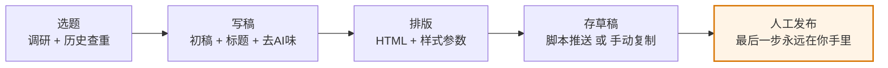

# 公众号内容流水线

**一套通用、可复用、可迁移的 AI 内容生产流程。** 选题 → 写稿（含标题、去 AI 味）→ 排版 → 存草稿 → 人工发布。

写图文内容的人，卡点往往不在"会不会用 AI"，而在每次都要重来一遍：重新想结构、重新调提示词、重新跟 AI 腔较劲、重新踩公众号草稿的坑。这套流程把这些重复劳动一次性固化下来——**主题是变量，流程和规矩不动**。

## 解决什么问题

| 你遇到的 | 这里怎么解 |
|---|---|
| 每次写稿从零想结构、想提示词 | 四步提示词串成流水线，前一步输出就是后一步输入 |
| AI 稿子一股套话、排比、鸡汤 | 去 AI 味清单逐条扫：必删 6 条、必改 6 条、红线 4 条 |
| 标题不是太平就是标题党 | 三组共 10 个备选，每个标注给谁看、靠什么吸引点击 |
| 事实数据不敢全信 AI | 【需核对】标记 + 独立清单，人工逐项查证，责任在人不推给工具 |
| 排版参数每次重调 | 字号、配色、视觉块密度是固化参数表，换账号只改值 |
| 推草稿踩坑：标题超限、图片不显示、报错看不懂 | 脚本前置拦截 + 正文图自动换微信域名 + 错误码中文翻译 |
| 换个主题就得换一套流程 | 流程不变，只换输入的那句"这次写什么" |

**适用场景**：职场干货、影评、行业解读、旅行攻略、产品测评、内部信息整理——任何"把一个主题写成图文"的场景。



**实际收益**：省掉的是重复劳动——不用每次从零搭结构、不用凭感觉改 AI 味、不用自己试错微信草稿的坑。判断不外包：写什么角度、数据对不对、最后发不发，始终在人手里。这里没有使用量或节省时间的数据，收益只说功能上确定成立的部分。

---

## 先说清楚：这不是什么

- **不是公文写作方案。** 这里没有述职报告模板、没有会议纪要范文、不针对任何特定文体。
- **不是成品内容库。** 不给你一篇篇可以直接发的文章，给你的是把任何主题做成文章的方法。
- **不是某个 AI 工具的专属配方。** 提示词是纯文本，复制到哪个 AI 工具都能用。

## 这是什么

一套"流程 + 提示词 + 规矩"。它解决的是同一个问题：**不管写什么主题，怎么稳定地把它从想法变成一篇排好版、躺在草稿箱里、等你点发布的文章。**

流程固定，主题可变。这就是它的全部价值。

## 换主题就能换场景

同一套流程，替换主题和风格设定，可以适配的内容类型（举例，非穷举）：

| 换成这个主题 | 就变成这类内容 |
|---|---|
| 职场 Excel 技巧 | 职场干货号 |
| 某部电影的观影感受 | 影评号 |
| 某个行业的新政策 | 行业解读号 |
| 一次旅行的攻略 | 旅行号 |
| 某款产品的测评 | 测评号 |
| 团队的周报 / 会议记录 | 内部信息整理 |

流程一次都不用改。改的只有输入的那句话——"这次写什么"。这就是通用流程和可复用流程的区别：成品只能用一个场景，流程能迁移到任何场景。

---

## 适合谁

- 自己运营公众号、知乎、小红书等图文账号的人
- 不想每次写稿都从零想结构、想提示词的人
- 接受"AI 出稿、人最后把关"这个分工的人

## 不适合谁

- 想要"输入主题就自动发表、完全不用管"的人——本流程最后一步永远人工点发布
- 期待 AI 保证事实准确、数据真实的人——提示词会提醒核对，但责任在使用者
- 只想找某个领域的现成范文的人——这里不提供成品内容

---

## 五分钟上手

1. 打开 `prompts/`，按 01 → 02 → 03 → 04 的顺序，把每个环节对应的提示词复制到你的 AI 工具里。
2. 在提示词里填上你这次的主题（任何主题都行）。
3. 上一步的输出，作为下一步的输入，串起来走完四步。
4. 最后一步产出的是排版好的内容：要么用脚本推进草稿箱，要么手动复制粘贴到公众号后台。
5. **去草稿箱检查，自己点发布。**

只用提示词的话，不需要装任何环境、不需要填任何密钥。脚本是给想省手动搬运的人准备的进阶选项。

完整说明见 `docs/quickstart.md`。

---

## 仓库结构

```
prompts/     四个环节的提示词模板（核心资产，复制到任意 AI 工具即可用）
templates/   可复制的文章结构骨架、风格设定模板
config/      个性化配置样例（署名、风格、历史文章清单）
scripts/     可选进阶脚本：环境自检、推草稿、Markdown 转 HTML
docs/        上手、流程、草稿箱权限、排错说明
examples/    走完一遍的脱敏示例
```

## License

MIT。随便用、随便改、随便分发。见 `LICENSE`。

## 一句提醒

流程能帮你省的是重复劳动，不是判断。写什么主题、从什么角度切入、这个数据对不对——这些决定还得你自己做。最后那一下"发布"，也始终在你手里。
